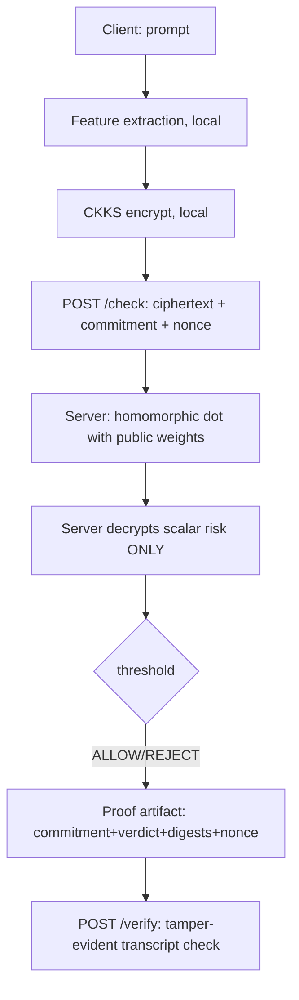

# zk-SAFEGUARD

Proof-of-concept for privacy-preserving prompt-safety checking: the client
evaluates nothing in the clear on the server — the prompt is turned into
features locally, encrypted with **CKKS (TenSEAL)**, and the server computes the
risk score **under encryption**, decrypting only the single aggregated score to
enforce the policy. A proof-of-decision artifact binds the decision transcript
so third parties can detect tampering.

**Status:** code complete, NOT YET EXECUTED. Run the verification below on your
machine for real measured numbers.

## Architecture



## What is cryptographically real vs prototype

| Component | Status |
|---|---|
| CKKS homomorphic linear scoring (TenSEAL) | **real FHE** — features encrypted client-side; server never sees the prompt or feature vector; only the aggregated scalar is decrypted |
| Server context without secret key handed to clients | real (`/setup` returns `save_secret_key=False` serialization) |
| SHA-256 salted commitments | real (binding under hash assumption; random salt per client) |
| Replay protection (nonce) | real, server-side |
| Proof-of-decision (`FiatShamirPrototype`) | **prototype** — a hash-bound transcript. Verifier recomputes the challenge from public fields, so tampering with any recorded field breaks verification. It is **NOT** a zk-SNARK: it is **not zero-knowledge and NOT sound** — anyone can mint an artifact. A real backend must implement `ProofBackend` (the interface raises `NotImplementedError` by design). |
| What the server sees | ciphertext + commitment + nonce + digests + decrypted scalar risk + verdict. The scalar risk/verdict are intentionally visible: the central service must enforce the decision. |
| NF4 quantized inference | local CPU study of NF4 quantization error (`scripts/nf4_study.py`); no GPU/T4 required, no claims of production quantized LLM serving |

## Setup

```bash
cd zk_safeguard
python -m venv .venv && source .venv/bin/activate
pip install -r requirements.txt    # Python 3.10-3.12 (TenSEAL wheels)
```

## Usage

```bash
python scripts/smoke_test.py      # 4 outcomes + replay + non-disclosure + latency
python scripts/benchmark.py --n 20
python scripts/nf4_study.py
uvicorn zksafeguard.protocol.server:app --port 8000   # live API
python -m pytest tests -q
```

## Sample output format

```
=== zk-SAFEGUARD SMOKE TEST ===
[1] valid input   -> verdict=ALLOW  proof_verified=True  (risk=<computed>)
[2] unsafe input  -> verdict=REJECT (risk=<computed>)
[3] tampered proof -> verified=False (expected False)
[4] modified context -> HTTP 400 (expected 400)
[5] replay         -> HTTP 409 (expected 409)
[6] non-disclosure -> no plaintext prompt tokens in server transcript
[7] measured /check latency: <computed> ms
```

The "unsafe" prompt in the smoke test is constructed from the public model
weights (tokens hashing to strong positive weight indices) so the encrypted
linear score deterministically exceeds the threshold — no plaintext rules run
on the server.

## Verification

`pytest`

For the full adversarial analysis — what each mechanism protects, what it
explicitly does not, and the deployment gaps — read
[docs/THREAT_MODEL.md](docs/THREAT_MODEL.md).

## Known limitations / honest scope

- The linear CKKS model is a toy risk scorer, not an LLM safety model.
- The proof backend is explicitly NOT a SNARK; no zero-knowledge or soundness
  claim is made. Interface provided for a real backend.
- Replay protection = single-use nonces (in-process) + a freshness window on
  the client timestamp (`protocol.max_nonce_age_seconds`, default 300 s); a
  stale request is rejected *without* consuming its nonce.
- Rule patterns (denylist/injection regexes) are examples, trivially evaded;
  they exist to make the policy engine testable.
- TenSEAL CKKS is CPU-bound here; latencies are measured, not optimized.
